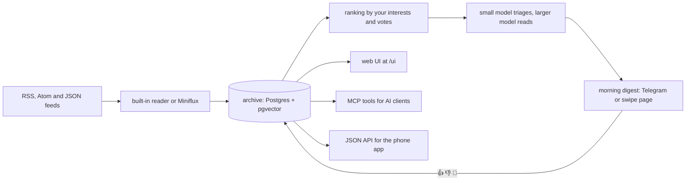

<!-- readme:header:start -->
<p>
  
  <a href="https://github.com/Egoushka/feed-eater/actions/workflows/ci.yml"></a>
  
</p>
<!-- readme:header:end -->

# feed-eater

> A self-hosted feed reader for one person: it archives everything you follow, sends the few items that matter each morning, and lets any AI client search the archive.

<!-- readme:status:start -->
**Active**. I work on it this month.
<!-- readme:status:end -->



## Why

I followed more feeds than I could read: on 2026-10-05 my Miniflux held 10,752 entries from 17 feeds, every one of
them unread ([design notes](docs/specs/2026-10-05-feed-eater-design.md#what-exists-checked-2026-10-05)). Feed
readers show everything in date order and leave the picking to you. I wanted a service that reads all of it, picks
the handful that touch my projects, says what I could do with each, learns from my reactions, and keeps the rest
searchable for an AI assistant instead of throwing it away.

## What it does

- **Reads your feeds itself** (RSS 2.0, Atom, JSON Feed, OPML import), or copies them from Miniflux, a self-hosted
  feed reader, if you already run one.
- **Keeps every entry** in a searchable archive, with duplicates and repeat stories across feeds linked together.
- **Sends a morning digest** of up to 12 items, each with a summary, why it matters and a suggestion, to Telegram or
  to a phone swipe page. 👍, 👎 and swipes teach the ranking.
- **Answers questions from the archive**, citing the items it used, in Telegram or through the API.
- **Saves items to its own library**, where they get full text and a summary, and come back if left unread.
- **Lets any MCP client search it.** MCP (Model Context Protocol) is how AI assistants call outside tools; feed-eater
  exposes five read-only ones.

Smaller jobs ride along: a twice-daily "which would you rather read" duel, following one story for two weeks,
release alerts for software you run, a weekly review, and weekly project ideas.

Not here: more than one user, a public instance (you run your own), and a hosted model (you
bring an OpenAI-compatible key). The Android app the [v1.0 spec](docs/specs/2026-10-19-v1.0-app.md) describes is
not built yet; the server side of it is.

## Quick start

You need Docker with Compose, an OpenAI-compatible API key (OpenAI by default), a Telegram account and an OPML file
of your feeds, or one feed URL.

```bash
curl -fsSL https://raw.githubusercontent.com/Egoushka/feed-eater/main/compose.example.yaml -o compose.yaml
curl -fsSL https://raw.githubusercontent.com/Egoushka/feed-eater/main/.env.example -o .env
mkdir config                                  # fill .env, create a bot with @BotFather, put feeds.opml here
docker compose up -d
# send /start to your bot, put the id it answers with in .env (FeedEater__Telegram__AllowedUserId), then:
docker compose up -d
docker compose run --rm feed-eater import-opml /config/feeds.opml
docker compose run --rm feed-eater doctor     # one line per integration: ok, off or FAIL with the fix
```

Then send `/digest` to the bot. [Setup](docs/SETUP.md) walks through each step, every optional integration and
upgrades. The embedding column is fixed at 1536 dimensions, so the embedding model must return that size (the
default does).

To build and test from source (Docker must be running; the tests start Postgres with pgvector in a container):

```bash
git clone https://github.com/Egoushka/feed-eater.git && cd feed-eater
dotnet test FeedEater.slnx
```

## How it works

One .NET 10 process and one Postgres 18 database with the pgvector extension for embeddings. An item travels like this:

1. Feeds are fetched every 30 minutes, by the built-in reader or by Miniflux. Each new entry has its HTML stripped,
   is marked a duplicate by canonical URL or title, and is embedded.
2. At 07:30 (in `FeedEater:TimeZone`, default UTC) the new items are ranked by vector math: fit to the projects and
   topics in `profile.json`, similarity to what you liked or disliked, and the feed's 👍 rate. No trained model is
   needed on day one.
3. The top 60 get a one-line verdict from a small model; the top 12 of those that matter are read in full by a
   stronger one, which writes a summary, why it matters, and a suggestion.
4. The digest goes out as one message or card per item. Your reactions feed back into step 2.

The invariant that keeps the bill flat: model spend is capped by those fixed counts, not by how many feeds you add;
only embeddings grow with volume. Every fetch of a page goes through one guarded fetcher that refuses private
addresses, so a feed cannot point the service at your own network
([page fetch rules](docs/specs/2026-10-06-page-fetch.md)).

## Numbers

| | Value | Source |
|---|---|---|
| Unread entries when I started | 10,752 from 17 feeds | [design notes](docs/specs/2026-10-05-feed-eater-design.md#what-exists-checked-2026-10-05), 2026-10-05 |
| Items a model reads per day | 60 triaged, at most 12 read in full | [How it works](#how-it-works) |
| Test methods | 1,000 `[Fact]`/`[Theory]` | `grep` over `tests/` at 3e07ef8 |
| Users | 1, me | counted |

## Lessons

I built swipe mode, a phone page with one card per screen, and then never opened it: on 2026-10-19 its tables held
zero rows, and I had not noticed it was live. Features that wait for you to visit them do not get visited. The
v1.0 work turns that around: every job writes to one inbox and the digest leads the swipe stack, so there is one
place to look ([v1.0 spec](docs/specs/2026-10-19-v1.0-app.md)).

## Docs

- [Setup](docs/SETUP.md): install, every optional integration, upgrading
- [Configuration](docs/CONFIG.md): every setting, its default and what it does (generated from the code)
- [Features in detail](docs/reference/features.md): the reader, web UI, taste map, clustering, duels, follows, autopsy, weekly ideas, MCP tools
- [Design](docs/specs/2026-10-05-feed-eater-design.md) and the later specs in [docs/specs](docs/specs/)
- [Plans](docs/plans/): one per release step

<!-- readme:footer:start -->
---

<sub>Made by [Yehor Hrabovskyi](https://hrabovskyi.online) · [Apache licence](LICENSE).</sub>
<!-- readme:footer:end -->
